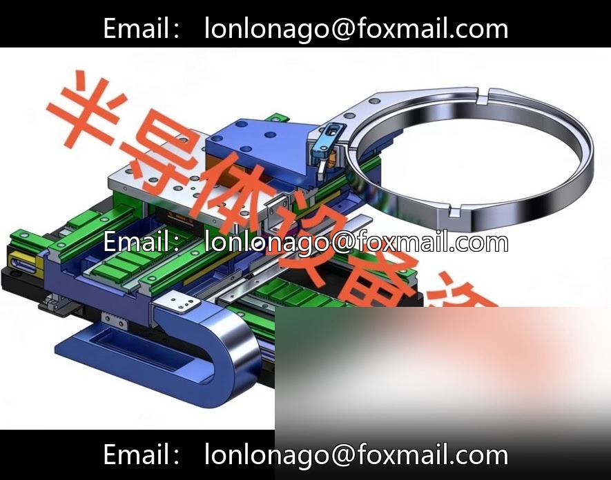
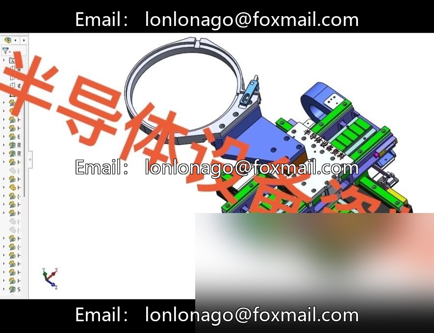
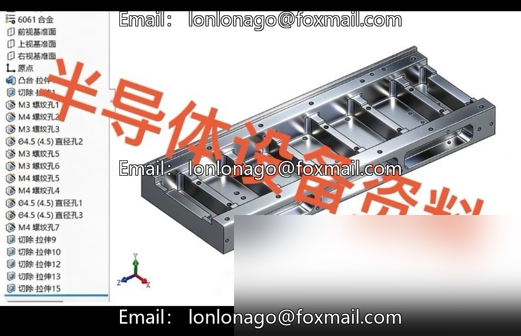

# XY platform 3D drawing of solid crystal machine: most parts have parameters, and industry-ready settings.

## Body

Solid crystal machine XY platform 3D drawing: most parts have editable parameters, a mature industry design! Sw2025

Upload directly to for electronic original files! The following image contains a screenshot of the file portion. Please confirm before placing an order! Because electronic file materials are copyable. So after purchase, no return is allowed! Thank you for understanding!

For personal learning and reference use only.

A 3D drawing for the solid-crystal machine XY platform is provided; most parts have editable parameters with mature industrial design; the images show semiconductor materials, alloy, reference planes, origins, thrusted parts, and thread holes.

<!-- AI_ENRICHED -->

## Images

## Payment

Here is a pay link on Stripe ( https://buy.stripe.com/3cs8yP7sY87d0vu9AB ). Please contact me lonlonago@foxmail.com after funding $89, and I will send you a complete data files , thank you!

